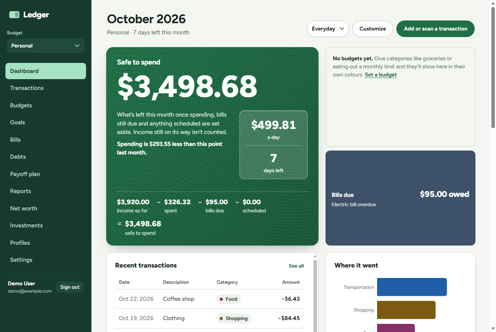
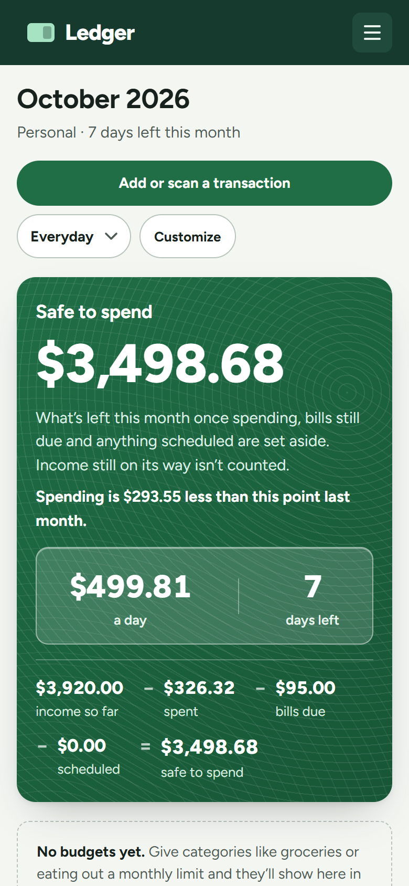

# Ledger

**A personal finance app for one person or a whole household:** everyday spending, bills and budgets, savings goals, debts, investments and net worth in one place. It answers the question most money apps bury: *am I OK this month?*

> "Ledger" is a working name; it's set in one place, `frontend/src/brand.js`.



<p align="center"></p>

---

## What it does

**Day to day**
- **Safe to spend:** income so far − spent − bills still due − anything scheduled. It shows the sum written out, an amount per day, and the change since this point last month.
- **Transactions:** add by hand, or **photograph a receipt or bill** (photo or PDF). A vision model running *on your own machine* reads the amount, date and merchant, so nothing is sent to an outside service. Search, filters, bulk edit, CSV export.
- **Bank import:** load the CSV your bank gives you (TD EasyWeb is supported, as is this app's own export).
  - Rows already imported are skipped.
  - Categories are filled in from your past choices, about 100 Canadian merchants, bank codes (e-transfers, NSF fees, TFSA and the like), and the local model for anything left.
  - Weekly, monthly and yearly repeats are flagged as recurring.
- **Budgets per category:** each category has its own colour. Budgets warn when spending is running ahead of the month.
- **Bills:** overdue, upcoming and paid. Marking a bill paid can record the expense too.

**Planning**
- **Savings goals:** a target and a date. It shows what to put in each month, plus contributions, withdrawals and history.
- **Payoff plan:** for your own loans and cards, it compares avalanche, snowball and minimum payments only, with the payoff date and total interest for each.
- **Reports:** income versus spending over time, and what you kept or overspent each month.

**Wealth**
- **Investments:** holdings priced live (Yahoo Finance) and converted to the budget's currency. Enter them by hand, import Wealthsimple's *Holdings report* CSV, or sync through SnapTrade.
- **Net worth:** accounts you own and owe with dated balances, investments at their live value, and a 12-month chart.

**Together**
- **Households:** share a budget by invite. Members see one shared ledger, and every row shows who added it. Owners manage membership.
- **Who owes what:** split shared costs equally or by amount, record paybacks, and see the fewest payments that settle everyone up.

**Make it yours**
- **A dashboard you arrange:** drag widgets anywhere, resize them, add or remove them. Wide screens get an 18-column grid. Save layouts as **presets**, which go with your account into every household.
- **Extra widgets:** financial news (CBC, Globe and Mail, MarketWatch, Bank of Canada) and Reddit (subreddits and threads you follow, ranked by upvotes and how recent they are).
- **Any currency** per budget, in about 30 currencies.
- **Install on your phone:** it's an installable web app with its own home-screen icon. No app store needed.

**Account safety**
- Password change and reset by email, "sign out everywhere", and rate-limited sign-in.
- Households keep their data when a member deletes their account.

---

## Tech stack

| | |
|---|---|
| Frontend | React 18, Vite, React Router (hash routing, so static hosts like GitHub Pages work), Recharts, react-grid-layout, Figtree |
| Backend | Node.js, Express, `pg` |
| Database | PostgreSQL. Numbered SQL migrations that run on start. Money is stored as integer cents |
| Auth | JWT (revocable through a per-user token version) and bcrypt |
| Scanning | [Ollama](https://ollama.com) with `qwen2.5vl:7b`, on your own machine |
| Tests | Node's built-in test runner, with every test file in its own throwaway Postgres schema. GitHub Actions runs them on each PR |

---

## Quick start

You need **Node.js 18+** and **PostgreSQL**. Receipt scanning also needs [Ollama](https://ollama.com); everything else works without it.

```bash
git clone https://github.com/Raagna/WebBudget.git
cd WebBudget
```

**1. API** (http://localhost:4000)

```bash
cd backend
npm install
cp .env.example .env     # set DATABASE_URL and a long random JWT_SECRET
npm run seed             # optional: demo data (see below)
npm start                # applies any new migrations, then starts
```

**2. Web app** (http://localhost:5173), in a second terminal:

```bash
cd frontend
npm install
npm run dev              # or: npm run dev:lan  to open it from your phone on the same Wi-Fi
```

Then sign in with the demo account, or register.

| Demo account | Password | What's in it |
|---|---|---|
| `demo@example.com` | `DemoPass123!` | A **Personal** (USD) and a **Household** (EUR) budget with about nine months of made-up history and some bills |
| `partner@example.com` | `DemoPass123!` | A member of that Household, to see what sharing looks like |

> Never run `npm run seed` against a real deployment: it creates accounts with publicly known passwords.

**3. Receipt scanning (optional)**

```bash
ollama pull qwen2.5vl:7b
```

The API looks for Ollama at `http://127.0.0.1:11434`. If it can't reach it, the scan button explains that, and you can enter the transaction by hand.

---

## Configuration

Everything is set in `backend/.env`. `backend/.env.example` lists every option with notes. The main ones:

| Variable | What it's for |
|---|---|
| `DATABASE_URL` | Postgres connection string. `?sslmode=require` (as Neon and Supabase give you) turns on SSL |
| `JWT_SECRET` | **Required.** A long random string; the server won't start without it |
| `CORS_ORIGIN` | Where the web app runs. Takes a comma-separated list, so two sites can share one API while you move |
| `TRUST_PROXY` | How many proxies sit in front of the API, so rate limits see real IPs. Automatic on Render |
| `SMTP_HOST`, `SMTP_USER`, `SMTP_PASS`, `SMTP_FROM`, `APP_URL` | Sending password-reset emails. Without them, the reset link is printed to the server console |
| `OLLAMA_URL`, `OLLAMA_MODEL` | The local model used for scanning and for categorizing imports |
| `SNAPTRADE_CLIENT_ID`, `SNAPTRADE_CONSUMER_KEY`, `SNAPTRADE_OWNER_EMAIL` | Optional automatic Wealthsimple sync |
| `REDDIT_CLIENT_ID`, `REDDIT_CLIENT_SECRET` | Optional. Without them the Reddit widget uses RSS and shows no upvote counts |
| `NEWS_FEEDS` | Optional. Replaces the default news feeds |

The frontend has one setting, `VITE_API_URL`, used for production builds. In development, Vite passes `/api` through to `localhost:4000`.

---

## Tests

```bash
cd backend  && npm test     # API tests against real Postgres
cd frontend && npm test     # layout, format and payoff logic
```

- **Isolated:** each backend test file creates and then drops its own Postgres schema, so tests never touch your data and can run in parallel.
- **Offline:** outside services (Yahoo, RSS, Reddit, SnapTrade, the local model) are replaced by small fake servers, so the suite runs offline.
- **CI:** `.github/workflows/tests.yml` runs both suites on every pull request and on `main`.

---

## Project layout

```
backend/
  server.js, app.js        start-up, and the Express app with every route mounted
  db/                      connection pool, migration runner, migrations/001 ... 019
  routes/                  one file per area: auth, transactions, budgets, bills, goals,
                           networth, investments, payoff, debts, dashboard, news, reddit, scan ...
  utils/                   the logic, kept testable: bank import, recurring detection, quotes,
                           payoff maths, debt splitting, RSS/Reddit readers, mail
  middleware/              auth (JWT and token version), input validation
  test/                    API tests (node:test)
  seed.js                  demo data
frontend/
  src/pages/               one page per menu item
  src/components/          forms, cards, and the dashboard grid and widgets (components/dashboard/)
  src/utils/               formatting, category colours, scan image prep, payoff maths
  public/                  icons, web app manifest, service worker
DESIGN.md, PRODUCT.md      the design system and who the app is for
docs/                      architecture, API reference, deployment
```

---

## More documentation

- **[Architecture and data model](docs/architecture.md):** how the pieces fit, every table, how money and dates are stored, households, security, and how to write a migration.
- **[API reference](docs/api.md):** every endpoint.
- **[Deployment](docs/deployment.md):** the free-hosting setup (Neon, Render, GitHub Pages), moving to your own server, installing on a phone, and running the scanner when the API is in the cloud.
- **[DESIGN.md](DESIGN.md):** colours, type, components and the rules behind them.
- **[PRODUCT.md](PRODUCT.md):** who it's for and what it should feel like.

---

## Notes

- **Not a bank.** Balances and transactions are what you enter or import. The only automatic connection is the optional SnapTrade sync for investments.
- **Unofficial data sources.** Stock prices come from Yahoo Finance's public chart endpoint, and news comes from public RSS feeds. Either can change without notice. Both are cached, and the app keeps working with the last good data.
- **License.** No license has been chosen yet, so all rights are reserved by default.
